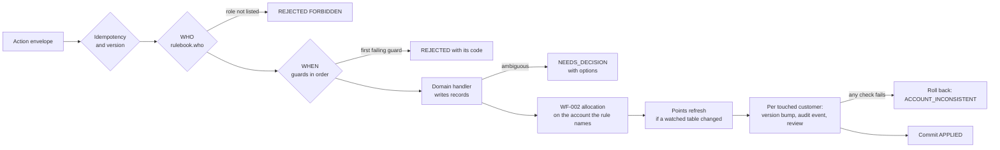

# Architecture — final

Stage 4 of 4. Describes what is implemented on `main` (Solution A) and on `solution-b-middle-ground` (Solution B). Earlier stages: [first draft](01-architecture-first-draft.md), [refined draft](02-architecture-refined-draft.md), [post-research](03-architecture-post-research.md).

## 1. Requirements broken into subproblems

| #   | Subproblem                                                             | Where it is solved                                        |
| --- | ---------------------------------------------------------------------- | --------------------------------------------------------- |
| 1   | Who may run an action                                                  | `RULEBOOK[type].who` (A) / `authorize` per handler (B)    |
| 2   | In which entity states an action is valid                              | Named guards in `rules/guards.ts` (A) / inline checks (B) |
| 3   | Quantity and money invariants (ACC-001/002, CRD-001, FUL-001, ORD-001) | Domain models, unchanged in both                          |
| 4   | Side effects of a change (WF-002 allocation, REW-002 points)           | `rules/reactions.ts` (A) / explicit calls (B)             |
| 5   | Undoing posted value without editing history (WF-001)                  | Linked negative rows + `SettlementService.release` (both) |
| 6   | Actions spanning two accounts                                          | `relatedCustomerIds` on the action context (both)         |
| 7   | Ambiguous intent (7.2)                                                 | Existing `DomainDecision` → `NEEDS_DECISION` (both)       |
| 8   | Proof that every action left a coherent state                          | Per-customer Audit review before commit (both)            |
| 9   | Rules readable by non-engineers                                        | Generated [rulebook.md](rulebook.md) (A)                  |

## 2. Runtime flow (Solution A)



Everything left of "Domain handler" and right of it up to the review is generic; the business content is the rulebook.

## 3. Rule definition semantics

A rule reads as a sentence: _&lt;who&gt; may &lt;does&gt; when &lt;each guard holds&gt;; afterwards &lt;allocates&gt;_.

```ts
MOVE_CUSTOMER_PAYMENT: {
  area: 'Accounts',
  does: 'Move a payment recorded against the wrong customer (FDSK-169)',
  who: ['ACCOUNTS'],
  when: [targetIsAnotherCustomer, targetCustomerExists,
         paymentBelongsToCustomer, paymentNotMoved, paymentFundsNoCredit],
  reads: ['receipt', 'charge', 'points'],
  allocates: 'receiving account',
  cites: ['CUS-001', 'ACC-002', 'WF-001', 'WF-002', 'REW-003'],
},
```

A guard is data plus one predicate:

```ts
export const paymentFundsNoCredit = guard({
  rule: 'CRD-001',
  says: 'The payment does not fund a credit note',
  allows: { receipt: ['FREE', 'ALLOCATED'] },
  holds: (f) => !f.receiptFundsCredit(),
  otherwise: { code: 'RECEIPT_FUNDS_CREDIT', message: '…' },
});
```

- `says` is what the generated rulebook shows to a non-engineer.
- `allows` feeds the scenario counter: from the same declarations, `pnpm rules:report` computes **84,480** naive combinations and **95** valid action/state combinations (193 counting permitted roles).
- `test/rulebook.test.ts` fails if the rulebook, the roles table in `business_terms.md`, the cited rule IDs or the generated document drift apart.

Reactions are declared with what they watch and what they write. A startup check enforces that no reaction watches a table a _later_ reaction writes, so one ordered pass is a fixed point (allocation → points).

## 4. The two features

### FDSK-169 — move a payment recorded against the wrong customer (ACC-004)

| Step | Record written                                                                           | Rule it keeps          |
| ---- | ---------------------------------------------------------------------------------------- | ---------------------- |
| 1    | Negative `payment_allocations` for every charge the receipt settles on the wrong account | WF-001, WF-003 release |
| 2    | New `payment_receipts` row on the right account, same bank reference and receipt time    | ACC-003 receipt order  |
| 3    | `payment_transfers` row linking both receipts; source capacity m′ = m − t = 0            | ACC-002                |
| 4    | WF-002 allocation on the **receiving** account only                                      | WF-002                 |
| 5    | Points refresh on both accounts; spent points become clawback pending                    | REW-002, REW-003       |

Assumptions: the whole receipt moves (a bank payment is one transaction); receipts that fund a credit note are refused because CRD-001 requires that backing to stay; the wrong account is **not** re-allocated automatically, because WF-002 does not list this occasion for it (Accounts can run _Allocate cash_).

### FDSK-170 — correct an overstated delivery (FUL-007)

| Step | Record written                                                                                   | Rule it keeps                   |
| ---- | ------------------------------------------------------------------------------------------------ | ------------------------------- |
| 1    | KAM enters the delivered quantity actually received per line; must satisfy r ≤ d′ < d            | FUL-001                         |
| 2    | For the latest confirmations first: a negative `deliveries` row linked by `corrects_delivery_id` | WF-001                          |
| 3    | Exactly one negative charge adjustment per corrective row, on that confirmation's own charge     | WF-005                          |
| 4    | Settlement above the new retained value released cash → credit → points                          | WF-003 order (shared primitive) |
| 5    | `DELIVERED` batch with undelivered units goes back to `DISPATCHED`                               | FUL-006                         |
| 6    | WF-002 allocation, then points refresh                                                           | WF-002, REW-002                 |

Assumption: the missing units are in transit (the user story). Units that never left the warehouse are a different correction and are out of scope.

## 5. Database schema changes

| Table               | Change                                                                                                                                                                                               | Migration                                                                   |
| ------------------- | ---------------------------------------------------------------------------------------------------------------------------------------------------------------------------------------------------- | --------------------------------------------------------------------------- |
| `payment_transfers` | New: `from_receipt_id` (unique), `to_receipt_id` (unique), `from_customer_id`, `to_customer_id`, `amount_paise > 0`, `reason`, `action_id`, `created_at`; check `from_customer_id <> to_customer_id` | `0006_payment_transfers.sql`                                                |
| `deliveries`        | New `corrects_delivery_id` (self reference) and `reason`; check now `qty > 0 and corrects_delivery_id is null` **or** `qty < 0 and corrects_delivery_id is not null`                                 | `0007_delivery_corrections.sql` (drizzle-kit's copy step was fixed by hand) |

No existing row is ever updated in place by either feature.

## 6. API

Both features are new commands on the existing `POST /api/crm/actions` endpoint, validated by the shared Zod schema.

```jsonc
{ "type": "MOVE_CUSTOMER_PAYMENT",
  "payload": { "customerId": "<wrong>", "receiptId": "<receipt>",
               "targetCustomerId": "<right>", "reason": "Bank ref shows Greenfield paid" } }

{ "type": "CORRECT_DELIVERY",
  "payload": { "orderId": "<order>", "shipmentId": "<shipment>",
               "items": [{ "shipmentLineId": "<line>", "deliveredQty": 6 }],
               "reason": "Six received; four in transit" } }
```

A move returns `aggregateVersions` for both customers and appears on both timelines. `GET /customers/:id/snapshot` gains `ledger.transfers`.

## 7. Design patterns used

| Pattern                         | Where                                         | Why here                                                                      |
| ------------------------------- | --------------------------------------------- | ----------------------------------------------------------------------------- |
| Specification / named predicate | `guards.ts`                                   | Conditions become reusable, citeable, printable                               |
| Table-driven dispatch           | `rulebook.ts` + `RulesEngine.handlers`        | Removes the 22-case switch and per-handler role checks                        |
| Reactive dependency chain       | `reactions.ts`                                | Points follow the tables they depend on, discovered from the action's effects |
| Compensating entries (ledger)   | negative allocations, deliveries, adjustments | WF-001: history is never edited                                               |
| Shared domain primitive         | `SettlementService.reduce/release`            | WF-003 release order defined once, used by returns and FDSK-170               |
| Unit of work + invariant review | `ActionsService` + `AuditService.review`      | Every touched account is checked before commit                                |

## 8. Solution A vs Solution B

| Measure                     | B — middle ground                     | A — rulebook                         |
| --------------------------- | ------------------------------------- | ------------------------------------ |
| Role checks in services     | 23 `authorize` calls                  | 0 (one table)                        |
| Hand-wired reaction calls   | 7 allocation + 9 points calls         | 0 (declared once)                    |
| State gates                 | Inline `if`s in handlers              | 14 named guards                      |
| Framework code              | 0                                     | ~716 lines in `server/src/rules`     |
| Add a WF-002 occasion       | Edit the handler, remember both calls | Add `allocates:` to one rule         |
| Rules readable without code | No                                    | Generated rulebook, checked by tests |
| Debugging a single action   | Read one method                       | Read the rule, then the handler      |

See the [decision guide](decision-guide.md) for when each is worth it.

## 9. Known limitations

- Guards cover status/state gates only; quantity and money limits stay in models and are not visible in the generated rulebook beyond rule IDs.
- Scenario counting treats entity states as independent and does not model reachability, so 95 is an upper bound on valid state combinations.
- A payment move checks the source account's `expectedVersion` only; the target is protected by the immediate transaction, not by an expected version.
- Points refresh is recomputed for every touched account when any watched table changes; correct but not incremental.
- Business terms version stays `2026-10-26.1` (tests pin it); ACC-004 and FUL-007 are marked as extensions in the rules document.
