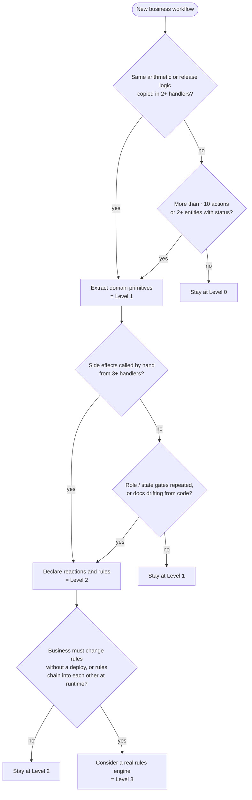

# When to invest in a rules framework

Deliverable 3. A decision tree and measurable signals for choosing between plain services, a middle-ground refactor (Solution B), and a declarative rulebook layer (Solution A). The numbers in the examples come from this repository.

## The three levels

| Level                         | What you build                                                                                                          | Framework cost here                                   | Typical fit                                                                  |
| ----------------------------- | ----------------------------------------------------------------------------------------------------------------------- | ----------------------------------------------------- | ---------------------------------------------------------------------------- |
| **0. Plain services**         | One handler per action; checks and side effects inline                                                                  | 0 lines                                               | Few actions, one or two state machines, one team                             |
| **1. Middle ground (B)**      | Shared domain primitives (settlement, balances), multi-entity boundary, value models; reactions still called explicitly | 0 framework lines; primitives replace duplicated code | Duplicated arithmetic or release logic, rules still mostly per action        |
| **2. Rulebook layer (A)**     | Declarative who/when/reactions per action, named guards, generated readable rulebook, drift tests                       | ~716 lines (`server/src/rules`)                       | Many actions sharing gates and side effects; rules reviewed by non-engineers |
| 3. Rules engine (Drools-like) | Inference over facts, rules chain implicitly                                                                            | 10k+ lines or a new runtime                           | Rules authored at runtime by the business; hundreds of interacting rules     |

## Decision tree

## Signals to measure

Count these with `git grep` before deciding; each has a threshold where the next level starts to pay.

| Signal                         | How to measure                                      | Level 1 when | Level 2 when                       | This repo (B → A)                                   |
| ------------------------------ | --------------------------------------------------- | ------------ | ---------------------------------- | --------------------------------------------------- |
| Duplicated value arithmetic    | Same formula in N places                            | N ≥ 2        | —                                  | 4 copies of `retained − cash − credit − points` → 1 |
| Hand-wired side-effect calls   | Calls to reaction functions at handler ends         | —            | ≥ 3 handlers                       | 16 calls in 7 handlers → 0                          |
| Repeated permission checks     | `authorize` calls vs. distinct role sets            | —            | calls > 2 × distinct sets          | 23 calls, 5 role sets → 1 table                     |
| Inline state gates             | Status `if`s in handlers                            | —            | same status checked in 2+ handlers | 14 named guards, 4 reused across actions            |
| Pruned scenarios               | Σₐ valid state combinations (from declarations)     | > ~20        | > ~50                              | 95 of 84,480 naive                                  |
| Files touched by a rule change | Files edited to add one WF-002 occasion             | —            | > 2                                | B: 1 handler, 2 calls; A: one `allocates:` line     |
| Doc/code drift risk            | Is there a non-code source of truth reviewers read? | —            | yes                                | `business_terms.md` roles now tested against code   |
| Cost to understand one action  | Files opened to see everything an action does       | —            | must stay ≤ 2                      | B: 1 file; A: rule + handler (2)                    |

The last row is the price of Level 2: behaviour is split between the rule and the handler. Pay it only when the rows above it are past their thresholds.

## Scoring shortcut

Score one point per row past its Level 2 threshold:

- **0–1 points** → Level 1. Extract primitives, keep handlers explicit.
- **2–4 points** → Level 2. Declare gates and reactions; generate the readable rulebook.
- **5+ points, plus runtime-editable rules** → evaluate Level 3.

This repo scores 5 (side effects, permissions, state gates, scenarios, drift) without needing runtime editing, so Level 2 is justified; a Level 3 engine is not.

## Why not always Level 2

- **Small apps.** With 5 actions and one status column, `rules/` would be larger than the business code it organizes. The brief's "10,000-line engine for 10–15 branches" is the same mistake at a larger scale.
- **Value-heavy rules.** Most of this domain's difficulty is arithmetic (FIFO allocation, release order, point rounding). Declarative guards do not make that shorter; shared primitives (Level 1) do. That is why both solutions share the settlement work.
- **Debuggability.** An implicit reaction is easy to forget when reading a handler. Level 2 mitigates this with a generated rulebook and an order check, but a team that never reads it would be better served by explicit calls.

## Solutions in this repository

|                             | Branch                     | Use it when                                                          |
| --------------------------- | -------------------------- | -------------------------------------------------------------------- |
| Solution B — middle ground  | `solution-b-middle-ground` | Fewer actions, small team, rules rarely reviewed outside engineering |
| Solution A — rulebook layer | `main`                     | Rules change often, several roles review them, side effects multiply |
